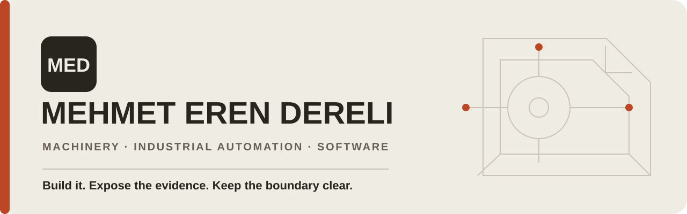

  <a href="https://www.mehmeterendereli.com/en">Website</a> ·
  <a href="https://www.mehmeterendereli.com/en/open-source">Open-source portfolio</a> ·
  <a href="https://www.linkedin.com/in/mehmeterendereli">LinkedIn</a> ·
  <a href="mailto:info@mehmeterendereli.com">Email</a>

I build inspectable systems across mechanics, motion, heat, control and software. My public work connects practical Windows tools, large-format additive manufacturing and deterministic automation. My product interests also include privacy-first, on-device AI.

Public repositories show what can be read, run and tested today. Customer work, private source, internal architecture and unreleased commercial products remain private.

## Featured · OpenRelax PC Care

### Review maintenance. Understand CPU spikes.

[OpenRelax](https://github.com/mehmeterendereli/openrelax) combines a Windows maintenance interface with **Fotokapan**, an independent recorder for sustained high-CPU episodes. Start with a read-only check, inspect the selected operations, and confirm before interactive cleanup.

**2.1 Preview · Windows PowerShell 5.1 · TR / EN · MIT · source-only**

**Start here:** [Download source ZIP](https://github.com/mehmeterendereli/openrelax/archive/refs/heads/main.zip) · [Run from source](https://github.com/mehmeterendereli/openrelax#run-from-source) · [Explore Fotokapan](https://github.com/mehmeterendereli/openrelax#fotokapan-cpu-spike-recorder)

**Maintenance you can inspect.** Corrupt settings stop scheduled cleanup. Recycle Bin, system-cache categories, RAM trimming and DNS flushing are opt-in. The read-only `-SelfTest` is separate from maintenance.

**A record after the CPU spike.** Fotokapan records process CPU shares and event times without command arguments. It is a high-CPU recorder, not a promise to diagnose every freeze; process names and timestamps are still diagnostic information.

**Evidence, not speed-up claims:** [Windows checks and review artifacts](https://github.com/mehmeterendereli/openrelax/actions/workflows/verify.yml) cover isolated safety, scan/cleanup, native-control and renderer paths. Source artifacts are unsigned Preview snapshots, not stable releases or LTS commitments. Elevated system integration and broader desktop configurations still need [release validation](https://github.com/mehmeterendereli/openrelax/blob/main/CONTRIBUTING.md#source-release-checklist).

[Report a reproducible issue](https://github.com/mehmeterendereli/openrelax/issues) · [Contribute](https://github.com/mehmeterendereli/openrelax/blob/main/CONTRIBUTING.md) · [Security reporting](https://github.com/mehmeterendereli/openrelax/blob/main/SECURITY.md)

---

## Engineering · VORMETRA Slice

[An OrcaSlicer-based workspace](https://github.com/mehmeterendereli/vormetra-slice) for a design-stage pellet-fed large-format additive-manufacturing system, with a public G1000 profile and the Python `vera-control` bridge.

**Try it:** [Install and run the portable checks](https://github.com/mehmeterendereli/vormetra-slice#quick-start) · [Inspect the control bridge](https://github.com/mehmeterendereli/vormetra-slice/tree/main/vera-control) · [Run the self-contained validation demo](https://github.com/mehmeterendereli/vormetra-slice/blob/main/vera-control/README.md#portable-first-result)

`C++` · `Python` · `OrcaSlicer` · `HTTP / MCP` · `AGPL-3.0 + MIT`

Reproducible example output, not a live status or hardware certification. The demo generates this card from its JSON report; it does not run a slicer or a physical printer. Physical-machine completion, throughput, accuracy and production reliability are not established by this check.

## What I am building toward

- **Machines:** custom machinery, extrusion systems, CAD/CAM and production-oriented mechanical design.
- **Automation:** PLC/HMI, motor drives, thermal-zone control, retrofit and commissioning.
- **Software:** deterministic control interfaces, testable Python/C++ systems and source-verifiable workflows.
- **Private AI:** device-side, privacy-first product experiences; only publicly released evidence is described here.

## Evidence before claims

Every public project should make four things easy to inspect:

1. **Architecture** — components and trust boundaries are traceable from source.
2. **Reproduction** — clone, run and test commands match the current tree.
3. **Safety** — refusal and failure behavior sit beside the happy path.
4. **Maturity** — design targets, software checks and physical results are kept distinct.

## Work together

For an engineering project, a reproducible bug report or an open-source contribution, start with [email](mailto:info@mehmeterendereli.com) or [LinkedIn](https://www.linkedin.com/in/mehmeterendereli). Repository-specific fixes are best opened against the relevant project so the discussion stays connected to source and tests.

Based in İstanbul, Türkiye · Public engineering profile maintained with explicit evidence boundaries.
